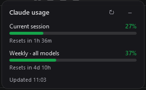

# Claude Usage Widget

[](https://github.com/MihirHarne/claude-usage-widget/actions/workflows/ci.yml)

A small Windows app that shows your Claude plan usage (the same numbers as
claude.ai → Settings → Usage) without opening a browser, and predicts when
you'll run out.



## Features

- **Tray icon** with your current session % drawn inside it, coloured
  green / orange / red. It pins itself to the visible part of the taskbar
  on Windows 11. Hover it for every limit and its reset time.
- **Desktop widget** with a bar per limit (current session, weekly
  all-models, weekly Sonnet, and any new limit claude.ai adds) and reset
  countdowns. Drag it anywhere; it remembers where you put it.
- **Pace marker**: the white tick on each bar shows how much of the window's
  *time* has passed. Fill past the tick means you're using the limit faster
  than time is passing.
- **Forecast**: "limit ~3:40 pm" tells you when you'll hit the limit at your
  current rate, or "on track" if you'll make it to the reset.
- **Usage history**: every reading is saved locally (SQLite), and the
  history window charts the last 24 hours, 7 days or 30 days.
- **Notifications** when a limit crosses 75% and 90% (configurable).
- **Start with Windows**, toggled from the tray menu.

## How it works

Anthropic doesn't publish an API for Pro/Max plan usage. The claude.ai
usage page loads its numbers from an internal endpoint
(`/api/organizations/<org-id>/usage`), and this app reads that same endpoint.

Instead of asking you to copy a session cookie out of your browser, the app
embeds its own Chromium browser (QtWebEngine). The first time it runs, a
sign-in window opens. You log in to claude.ai normally, and the app keeps
that session in its own browser profile on disk. After that, a hidden page
in the same profile requests the usage JSON every couple of minutes. No
password, cookie or key is ever stored in the project or in `.env`.

**Forecasting.** Each limit is a rolling window (5 hours or 7 days), and
claude.ai reports when it resets, so the app knows how far through the
window you are. To predict when you'll hit 100%, it fits a least-squares
line through your recent readings in the current window (the last hour for
the session, the last day for weekly limits). With too few readings, it
uses your average rate since the window started instead. It only warns
when the predicted time is comfortably before the reset.

Because the endpoint is unofficial, a claude.ai update can break it. When
that happens the widget keeps the last values and says it couldn't refresh.

```
main.py                     entry point: single-instance lock, logging, Ctrl+C handling
usage_widget/
  config.py                 .env settings and constants
  models.py                 parse claude.ai JSON, pick org, format values (unit tested)
  forecast.py               pace and limit-hit forecasting (unit tested)
  history.py                SQLite store of readings (unit tested)
  fetcher.py                hidden browser page that requests the usage JSON
  login_window.py           sign-in window sharing the same browser profile
  web_pages.py              browser page classes (pop-ups for Google sign-in, quiet console)
  app.py                    wires tray, widget, fetcher, history, notifications, menu
  desktop_widget.py         the floating panel and its pace bars
  history_window.py         the usage history chart (QtCharts)
  icons.py                  draws the tray icon with the number in it
  tray_pin.py               keeps the tray icon visible on the Windows 11 taskbar
  autostart.py              Start with Windows (HKCU Run registry key)
assets/icon.ico             app icon for the .exe
tests/                      pytest tests
.github/workflows/          CI on every push; build + GitHub Release on version tags
```

## Download

Grab the latest `ClaudeUsageWidget-vX.Y.Z-windows.zip` from
[Releases](https://github.com/MihirHarne/claude-usage-widget/releases), unzip
it anywhere, and run `ClaudeUsageWidget.exe`.

## Run from source (Windows)

```powershell
python -m venv .venv
.venv\Scripts\activate
pip install -r requirements-dev.txt
python -m pytest
python main.py
```

The sign-in window opens on first run. "Continue with Google" opens in a
pop-up; if Google refuses the built-in browser, use **Continue with email**.

Left-click the tray icon to show or hide the widget. Right-click the tray
icon or the widget for the menu.

### If the tray icon stays hidden under `^`

The app turns on **Always show icon on taskbar** by default. If Windows
still hides it (for example on Windows 10), open **Settings →
Personalization → Taskbar → Other system tray icons** and switch
ClaudeUsageWidget on.

## Settings (`.env`, optional)

Copy `.env.example` to `.env` next to `main.py` or the .exe.

| Key | Default | Meaning |
| --- | --- | --- |
| `REFRESH_SECONDS` | `120` | How often to check (minimum 60) |
| `WARN_PERCENT` | `75` | Orange colour and first notification |
| `CRITICAL_PERCENT` | `90` | Red colour and second notification |
| `TRAY_METRIC` | `five_hour` | Number in the tray icon: `five_hour`, `seven_day`, `seven_day_sonnet` or `highest` |
| `NOTIFICATIONS` | `true` | Windows notifications on threshold crossings |

## Build the .exe locally

```powershell
pyinstaller --noconfirm --noconsole --name ClaudeUsageWidget --icon assets/icon.ico main.py
```

The result is in `dist\ClaudeUsageWidget`. The folder is around 200 MB
because it bundles Chromium for the sign-in browser.

## Releasing a new version

1. Bump `__version__` in `usage_widget/__init__.py` (e.g. `0.3.0`) and commit.
2. Tag and push:

   ```powershell
   git tag v0.3.0
   git push origin v0.3.0
   ```

GitHub Actions runs the tests, builds the .exe on Windows, zips it, and
publishes a release with the zip attached. The workflow refuses to release
if the tag doesn't match `__version__`.

## Troubleshooting

- Logs: `%LOCALAPPDATA%\ClaudeUsageWidget\app.log`
- Usage history database: `%LOCALAPPDATA%\ClaudeUsageWidget\history.db`
  (readings older than 60 days are deleted automatically)
- Stuck on "Sign-in needed": right-click → **Sign in again…**
- Saved settings (widget position, org id) live in the registry under
  `HKCU\Software\MihirHarne\ClaudeUsageWidget`. Delete that key to reset them.
